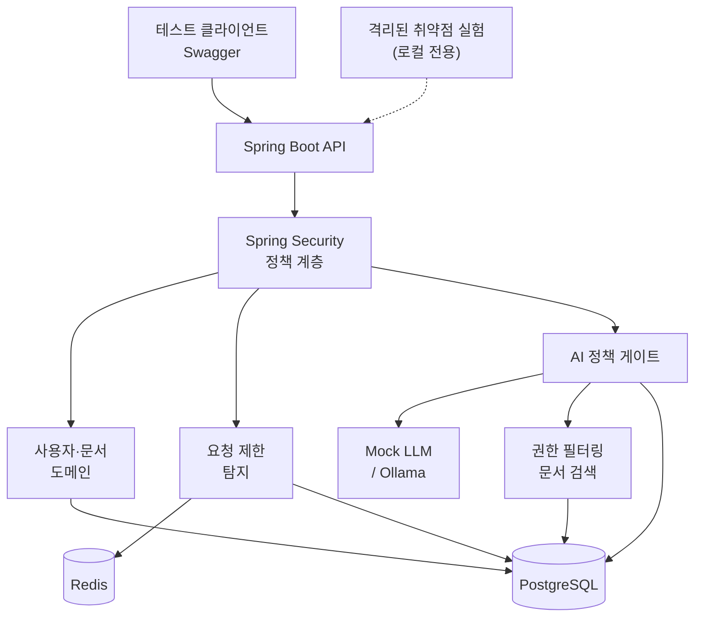
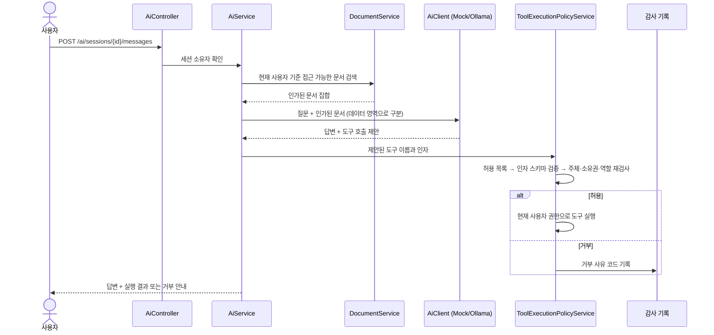
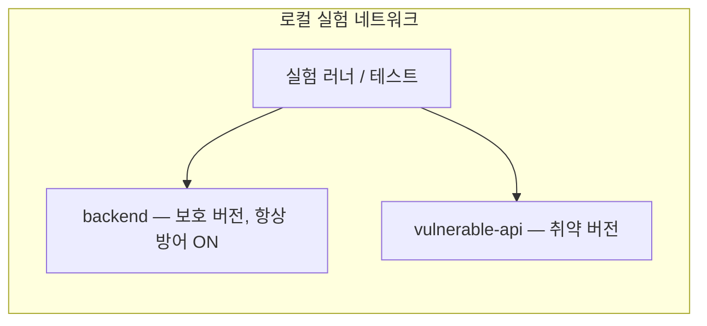

# 아키텍처

> 상태: 초안 (기획 단계). 구현하면서 갱신한다.

## 1. 시스템 구성

- **모듈형 모놀리스:** 하나의 Spring Boot 앱 안에서 패키지로 모듈을 나눈다. MSA는 비목표다.
- **인가 결정 위치:** 모든 인가 판단은 Spring Boot의 정책 서비스에서 한다. 모델, 클라이언트, 검색 결과는 인가를 결정하지 않는다.

## 2. 모듈

| 패키지 | 책임 | 하위 패키지 | 의존 |
| --- | --- | --- | --- |
| `auth` | 가입, 로그인, 로그아웃, Security 설정, 인증 주체 | controller, service, dto, security | user |
| `user` | 사용자 엔티티·조회, 프로필 접근 제어 | controller, service, entity, repository | — |
| `document` | 문서 CRUD, 소유권·공개 범위 인가 | controller, service, entity, repository | user |
| `securitylab` | 로그인 탐지, 요청 제한, 감사 이벤트, 보안 이벤트·지표 조회 | controller, detection, ratelimit, audit | user |
| `ai` | AI 세션, 권한 필터링 검색, LLM 클라이언트(Mock/Ollama), 도구 정책 게이트 | controller, service, model, policy, tools | document, securitylab |
| `experiment` | 시나리오, 실험 실행, 결과 집계 (`lab` 프로필 전용) | controller, service, runner | securitylab, ai |
| `global` | 공통 설정, 예외 처리, 에러 응답, requestId | config, exception, response | — |

**의존 규칙**

- 도메인 모듈(`auth`~`ai`)은 `experiment`에 의존하지 않는다. `experiment`를 통째로 빼도 본 서비스는 돌아가야 한다.
- `ai`는 `document`의 리포지토리를 직접 쓰지 않고, 인가가 적용된 `document` 서비스 조회를 거친다. 문서 인가 로직을 한 곳에만 둔다.
- 모든 모듈은 `global`을 쓸 수 있고, `global`은 다른 모듈에 의존하지 않는다.

## 3. 요청 처리 흐름 (일반 API)

1. **RequestId 필터** — `X-Request-Id`를 발급하거나 전달받아 MDC에 넣는다. 로그, 보안 이벤트, 에러 응답에 같은 값을 쓴다.
2. **요청 제한** (4주차) — Redis 기반, 초과 시 429 + `Retry-After`. 로그인처럼 인증 전에 막아야 하는 것(IP 기준)과 인증 후 사용자 기준 제한의 위치는 4주차에 정한다.
3. **Spring Security** — 세션 인증, CSRF 검사, URL 수준 역할 검사.
4. **Controller** — 입력 검증(Jakarta Validation).
5. **Service** — 객체 수준 인가(소유권), 도메인 로직.
6. **전역 예외 처리** — 공통 에러 형식. 스택 트레이스와 쿼리는 응답에 넣지 않는다.
7. **감사** — 거부·차단 같은 보안 판정은 `security_events`에 기록한다.

## 4. AI 문서 보조 흐름

- 도구 실행은 공개 API(`/ai/tools/execute`)로 열지 않고 서버 내부 서비스로만 둔다. 관리자 실험 API도 이 정책을 건너뛸 수 없다.
- 문서 내용은 모델 입력에서 "데이터"로 구분해 넣는다. 다만 이것만으로 인젝션을 막을 수는 없다고 보고, 실제 방어선은 정책 게이트로 둔다.

## 5. 신뢰 경계

| 입력 | 신뢰 수준 | 처리 |
| --- | --- | --- |
| 클라이언트 요청 (경로 ID, 쿼리, 바디) | 불신 | 입력 검증 + 서버 측 인가 |
| 세션 쿠키 | 서버가 검증한 경우만 | Spring Security |
| 문서 내용 (사용자 작성) | 불신 | 모델 입력 시 데이터로 취급, 지시로 해석하지 않음 |
| 모델 출력 (답변, 도구 호출) | 불신 | 허용 목록, 스키마 검증, 권한 재검사 |
| 시나리오 페이로드 | 합성 데이터 | 실험 환경에서만 사용 |

## 6. 실험 격리

- 취약 로직은 본 API에 feature flag로 넣지 않는다. 별도 앱으로 두고 본 backend 빌드 산출물에 포함하지 않는다. 위치와 방식은 [ADR-0002](adr/0002-isolated-vulnerable-lab.md)에서 정한다.
- 실험 관리 API(`/scenarios`, `/experiments`)는 `lab` 프로필에서만 등록한다.

## 7. 배포 기본값

- DB·Redis·관리 포트는 `127.0.0.1`에만 바인딩한다.
- Actuator는 `health`만 노출한다.
- `lab` 프로필은 기본값이 아니며, 실험 기능은 외부에 공개하지 않는다.
- HTTPS 환경에서는 Secure 쿠키를 강제한다.
