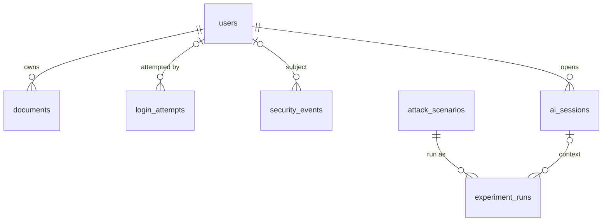

# 데이터베이스 설계

> 상태: 초안. 실제 스키마의 기준은 `backend/src/main/resources/db/migration/`의 Flyway 스크립트다.

## 1. ERD

## 2. 테이블 (기획서 기준 7개)

| 테이블 | 주요 컬럼 | 인덱스·제약 |
| --- | --- | --- |
| `users` | `id`, `email`, `password_hash`, `role`, `enabled`, `created_at` | PK(id), UNIQUE(email), CHECK(email = lower(email)), CHECK(role IN ('USER','ADMIN')) |
| `documents` | `id`, `owner_id`, `title`, `content`, `visibility`, `created_at`, `updated_at` | FK(owner_id → users), INDEX(owner_id), CHECK(visibility IN ('PRIVATE','PUBLIC')) |
| `login_attempts` | `id`, `user_id` nullable, `email_digest`, `ip_address`, `success`, `created_at` | FK(user_id → users), INDEX(created_at), INDEX(ip_address, created_at) |
| `security_events` | `id`, `user_id` nullable, `event_type`, `severity`, `action`, `request_id`, `occurred_at` | FK(user_id → users), INDEX(event_type, occurred_at) |
| `ai_sessions` | `id`, `user_id`, `model_name`, `status`, `created_at` | FK(user_id → users), INDEX(user_id, created_at) |
| `attack_scenarios` | `id`, `code`, `category`, `title`, `payload`, `expected_outcome` | UNIQUE(code), **합성 페이로드만** 보관 |
| `experiment_runs` | `id`, `scenario_id`, `session_id` nullable, `defense_enabled`, `success`, `latency_ms`, `created_at` | FK(scenario_id → attack_scenarios), FK(session_id → ai_sessions), INDEX(scenario_id, created_at) |

## 3. 설계 결정

- PK는 `BIGINT`로 통일하고, Flyway `V1__init_schema.sql`부터 이력을 관리한다.
- 비밀번호는 Argon2id 또는 검증된 Spring Security `PasswordEncoder`로 단방향 해시한다.
- 권한 판단은 문서의 `owner_id`와 인증된 사용자 `id`로 한다. URL의 숫자를 바꾼다고 권한이 생기면 안 된다.
- 로그인 기록에 평문 비밀번호, 세션 토큰, API 키를 저장하지 않는다. IP와 계정 식별자는 보존 기간(로컬 실험 7~30일)을 둔다.
- LLM 입력 원문이나 문서 전문을 불필요하게 저장하지 않는다. 시나리오 ID, 요청 ID, 정책 판정 코드 위주로 저장한다.
- AI 문서 검색은 DB에서 권한이 확인된 집합만 가져와 모델에 넘긴다.

## 4. 보완 제안 (미확정)

기획서 검토에서 나온 제안이다. 근거는 [plan-summary.md](planning/plan-summary.md) 7장.

### I-2 실험 결과 분리 기록

"모델 반응"과 "실제 행위"를 따로 세기 위해 `experiment_runs`를 넓힌다.

| 추가 컬럼 | 타입 (예시) | 의미 |
| --- | --- | --- |
| `target` | `VARCHAR` (`VULNERABLE` / `PROTECTED`) | 실험 대상 |
| `model_complied` | `BOOLEAN` nullable | 모델이 악성 지시를 따랐는지 (AI 시나리오만) |
| `action_executed` | `BOOLEAN` | 보안 목표 침해가 실제로 일어났는지 (무단 조회·실행·유출) |
| `policy_code` | `VARCHAR` nullable | 정책 판정 코드 (예: `TOOL_NOT_ALLOWED`) |
| `http_status` | `SMALLINT` nullable | 응답 상태 코드 |

ASR은 `action_executed` 기준으로 계산한다. 기존 `success`는 `action_executed`로 바꾸거나 없앤다.

도구 호출 감사용 테이블 `ai_tool_calls`를 추가한다.

| 컬럼 | 의미 |
| --- | --- |
| `id` | PK |
| `session_id` | FK → `ai_sessions` |
| `tool_name` | 모델이 제안한 도구 이름 (허용 목록 밖이어도 기록) |
| `args_digest` | 인자 해시 (원문 저장 안 함) |
| `decision` | `ALLOWED` / `DENIED` |
| `reason_code` | 거부 사유 (예: `NOT_IN_ALLOWLIST`, `SCHEMA_INVALID`, `NOT_OWNER`) |
| `request_id` | 요청 추적 ID |
| `created_at` | 생성 시각 |

### I-3 `security_events` 보강

`ip_address`, `resource_type`, `resource_id`, `reason_code` 컬럼을 추가해 "누가, 무엇에, 왜 거부됐는지"를 판정 코드로 남긴다.

### I-5 `email_digest`

단순 SHA-256 대신 서버 비밀키를 쓰는 HMAC-SHA256으로 만든다. 이메일 목록으로 사전 대입해 원래 값을 찾는 것을 막는다.

## 5. 마이그레이션 규칙

- 파일 이름: `V{번호}__{설명}.sql` (예: `V1__init_schema.sql`, `V2__login_attempts.sql`)
- 이미 적용한 마이그레이션은 고치지 않고 새 버전으로 추가한다.
- 나머지 테이블은 기능을 만드는 주차에 `V2` 이후로 추가한다.
- PK는 `BIGINT GENERATED BY DEFAULT AS IDENTITY`, 시각은 `TIMESTAMPTZ`를 쓴다.
- 제약 이름은 `uk_`/`fk_`/`ck_` + 테이블 + 컬럼으로 짓는다 (예: `uk_users_email`). PK는 PostgreSQL 기본 이름(`users_pkey`)을 쓴다.

### 적용 현황

| 버전 | 내용 | 작성일 |
| --- | --- | --- |
| V1 | `users`, `documents`, `idx_documents_owner_id`. 기획서 제약에 이메일 소문자·역할 CHECK 추가 | 2026-11-20 |
| V2 | `security_events` — 기획서 컬럼 + I-3(`reason_code`, `resource_type`, `resource_id`, `ip_address`), severity CHECK, (event_type, occurred_at)·(occurred_at) 인덱스 | 2026-11-20 |

> 이메일 소문자 CHECK는 대소문자만 다른 이메일로 중복 가입하는 것을 막는다. 애플리케이션은 저장 전에 이메일을 소문자로 정규화해야 한다.
