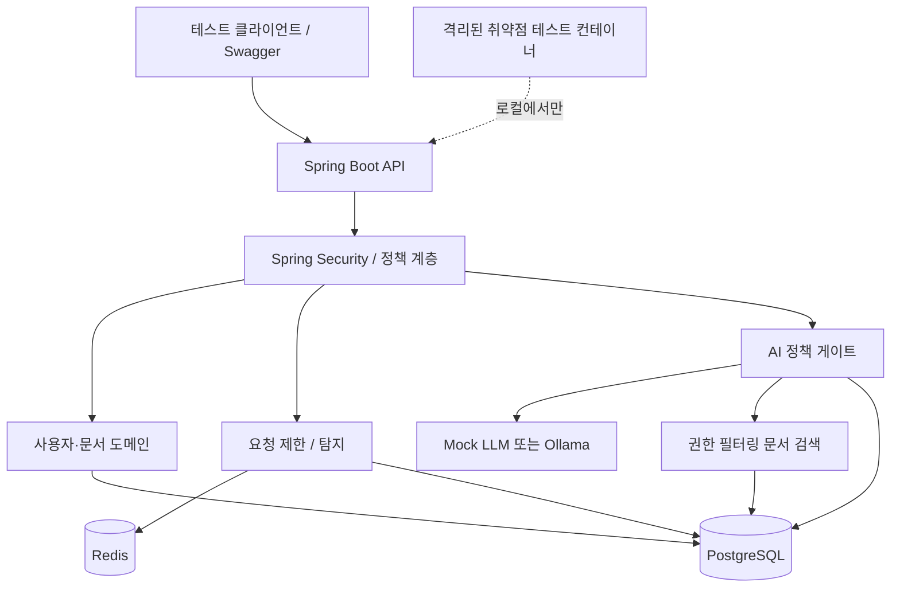

# SecureLab AI — 백엔드·AI 보안 실험 플랫폼 개발 기획서

> **추천 GitHub 저장소:** `securelab-ai`  
> **작성 기준일:** 2026-11-20  
> **개발자 환경:** Windows / RAM 32GB 이상 / GPU 미확인  
> **예산:** 로컬 개발 서비스 비용 0원 목표(기존 PC, 전기료 제외)  
> **형태:** 독립 GitHub 저장소, 백엔드 중심 포트폴리오 프로젝트

## 1. 프로젝트 개요

### 한 줄 소개

가상의 기업 내부 시스템을 만들고, **API 인증·인가 취약점과 AI Prompt Injection 시나리오를 안전한 로컬 환경에서 재현·탐지·방어·측정**하는 실험 플랫폼.

### 개발 목적

- Spring Boot로 실제 운영에 가까운 API 서버의 인증·인가 및 도메인 로직 설계.
- IDOR/BOLA, 과도한 요청, 반복 로그인 시도 등의 취약점에 대한 **서버 측 방어** 구현.
- 문서 기반 AI Agent가 신뢰할 수 없는 입력을 읽을 때 발생하는 **Prompt Injection**과 권한 우회 시도를 실험.
- 자동화 테스트와 감사 로그를 통해 **보안 적용 전후 결과를 정량적**으로 설명.
- 최종 산출물: 소스 코드, 아키텍처 문서, 위협 모델, 재현 테스트, 실험 보고서, 시연 영상.

### 가상 업무 시나리오

중소기업의 고객·사내문서 시스템이 있다. 일반 직원은 자신의 문서만 열람할 수 있고, 관리자는 보안 이벤트를 확인한다. 공격 시뮬레이터가 무단 문서 조회·대량 요청을 만들어낸다. AI 비서가 문서 요약을 제공하지만 문서에 악성 지시가 포함될 수 있다. 서버는 도구 실행 시 인증 주체·문서 소유권·권한을 **반드시 재검증**해야 한다.

### 비목표

- 실제 외부 사이트 공격 및 실사용자 데이터 수집.
- AI가 내린 판단만으로 영구 차단하는 기능.
- 첫 버전의 MSA/Kubernetes/Kafka/결제/복잡한 프론트엔드.
- 실서비스 배포를 전제로 한 공격 재현 엔드포인트.

## 2. 기술 스택 및 선택 근거

| 영역 | 기술 | 도입 시점 및 이유 |
| --- | --- | --- |
| 언어 | Java 21 LTS | Java 백엔드 역량 및 장기 지원 |
| 프레임워크 | Spring Boot 4.1.x / Gradle | 시작 시 안정 패치 버전 고정·라이브러리 호환성 확인 |
| API | Spring Web MVC, Jakarta Validation | REST API, 입력 유효성 검사 |
| 인증·인가 | Spring Security | 세션 인증, 역할 및 리소스별 접근 제어 |
| DB | PostgreSQL | 트랜잭션, 제약조건, 이벤트 저장 |
| ORM/마이그레이션 | Spring Data JPA, Flyway | 데이터 접근과 스키마 버전 관리 |
| 요청 제한 | Redis | 기간별 요청 횟수/잠금 상태, 4주 차 도입 |
| AI | Mock LLM → Ollama + Spring AI | GPU 확인 전 Mock 우선, 이후 소형 로컬 모델 |
| 자동 테스트 | JUnit, Spring Boot Test, Testcontainers | 인증·인가 및 DB·Redis 통합 테스트 |
| 문서/운영 | springdoc-openapi(호환 버전 확인), Actuator | API 확인, 헬스 체크 |
| 부하 테스트 | k6 | 요청 제한·지연·오탐 측정 |
| 개발 환경 | WSL2, Docker Compose, GitHub | 로컬 재현성 및 비용 절감 |

> **버전 주의:** 기획서에서 버전을 임의로 확정하지 않는다. 프로젝트 생성 시 Spring Boot 4.1.x와 각 Starter·Spring AI·springdoc의 **호환 조합**을 확인하고 `gradle.lockfile` 등으로 확정한다.
>
> **GPU 미확인:** 최초 AI 기능은 `MockAiClient`로 정책 검증. 이후 CPU에서도 실행 가능한 소형 모델(대략 1~3B 파라미터급)을 Ollama로 평가한다. 모델별 RAM/속도는 직접 확인한다.

## 3. MVP 범위와 우선순위

| 모듈 | 범위 | 우선순위 | 완료 기준 |
| --- | --- | --- | --- |
| M1 인증/사용자 | 회원가입, 로그인, 세션 종료, 사용자/관리자 분리 | P0 | 비로그인 401, 무권한 403 |
| M2 문서 API | 비공개 문서 CRUD, 소유권 검사 | P0 | 타인 문서 조회·수정 불가 |
| M3 보안 실험 | 로컬 격리 환경의 취약 API 테스트·보호 버전 검증 | P0 | 공격 재현/방어 회귀 테스트 통과 |
| M4 탐지/제한 | 로그인 시도 기록, Redis 기반 Rate Limiting, 감사 이벤트 | P0 | 설정 한도 초과 시 429, 보안 이벤트 조회 가능 |
| M5 AI 문서 보조 | 문서 검색·요약, 도구 호출 제안 | P1 | 접근 가능한 문서만 검색·참조 |
| M6 AI 정책 엔진 | Prompt Injection 실험, 도구 실행 시 서버 권한 재검사 | P1 | 불허 도구 호출 실제 실행 0건 |
| M7 실험 리포트 | 이벤트 목록, 시나리오 결과, 지표 요약 | P1 | 실험별 성공률·지연 통계 확인 |

**범위 관리:** 최초 4주간 M1~M4에 집중. AI는 인증·인가 테스트가 안정된 뒤 추가한다.

## 4. 시스템 아키텍처



- **모듈형 모놀리스:** `auth`, `user`, `document`, `securitylab`, `ai`, `experiment` 패키지로 구분.
- **신뢰 경계:** 모델 출력·검색 문서·클라이언트 요청 모두 불신. 인가 결정은 Spring Boot 정책 서비스에서 수행.
- **실습 격리:** 실험용 취약 로직은 일반 API의 feature flag로 열지 말고, 네트워크·프로필이 격리된 테스트 전용 애플리케이션/컨테이너에 둔다.
- **배포 기본값:** 개발 DB 포트와 관리 API는 localhost에만 바인딩하고, 실험 기능은 외부 공개하지 않는다.

## 5. 데이터베이스 설계

### 테이블 7개

| 테이블 | 주요 컬럼 | 인덱스·제약 |
| --- | --- | --- |
| `users` | `id`, `email`, `password_hash`, `role`, `enabled`, `created_at` | PK(id), UNIQUE(email) |
| `documents` | `id`, `owner_id`, `title`, `content`, `visibility`, `created_at`, `updated_at` | FK(owner_id → users), INDEX(owner_id), CHECK(visibility IN ('PRIVATE','PUBLIC')) |
| `login_attempts` | `id`, `user_id` nullable, `email_digest`, `ip_address`, `success`, `created_at` | FK(user_id → users), INDEX(created_at), INDEX(ip_address, created_at) |
| `security_events` | `id`, `user_id` nullable, `event_type`, `severity`, `action`, `request_id`, `occurred_at` | FK(user_id → users), INDEX(event_type, occurred_at) |
| `ai_sessions` | `id`, `user_id`, `model_name`, `status`, `created_at` | FK(user_id → users), INDEX(user_id, created_at) |
| `attack_scenarios` | `id`, `code`, `category`, `title`, `payload`, `expected_outcome` | UNIQUE(code); **합성 페이로드만** 보관 |
| `experiment_runs` | `id`, `scenario_id`, `session_id` nullable, `defense_enabled`, `success`, `latency_ms`, `created_at` | FK(scenario_id → attack_scenarios), FK(session_id → ai_sessions), INDEX(scenario_id, created_at) |

### 설계 결정

- MVP는 PK를 `BIGINT`로 통일하고 Flyway `V1__init_schema.sql`부터 이력 관리.
- 암호는 `Argon2id` 또는 검증된 Spring Security PasswordEncoder를 이용하여 단방향 해시 저장.
- 권한 판단은 문서의 `owner_id`와 인증된 사용자 `id`로 수행. 단순 URL 숫자 변경으로 권한을 얻을 수 없어야 한다.
- 로그인 기록에는 평문 비밀번호·세션 토큰·API 키를 절대 저장하지 않는다. IP 및 계정 식별자는 보존 기간(예: 로컬 실험 7~30일)을 명시.
- 로그에 LLM 입력 원문이나 문서 전문을 불필요하게 저장하지 않는다. 시나리오 ID·요청 ID·정책 판정 코드 중심으로 저장.
- AI 문서 검색은 DB에서 권한이 확인된 집합만 가져온 뒤 모델에 전달한다. 응답 후 텍스트 필터만 사용하는 접근은 불충분하다.

## 6. API 명세 초안

기본 경로: `/api/v1`. 로그인은 **세션 쿠키 방식**을 기본으로 한다. 세션 쿠키는 HttpOnly·SameSite를 적용하고, 브라우저 기반 상태 변경 요청에는 CSRF 방어를 적용한다. HTTPS 배포 시 Secure 쿠키를 강제한다.

| 메서드 | 경로 | 권한 | 설명 |
| --- | --- | --- | --- |
| POST | `/auth/signup` | 익명 | 가입 / 이메일 중복 검사 |
| POST | `/auth/login` | 익명 | 로그인 / 실패 기록 |
| POST | `/auth/logout` | 로그인 | 세션 무효화 |
| GET | `/users/me` | 로그인 | 내 프로필 |
| GET | `/users/{id}` | 본인 또는 관리자 | 프로필 접근 제어 확인 |
| POST | `/documents` | 로그인 | 문서 작성 |
| GET | `/documents` | 로그인 | 접근 가능한 문서 목록 |
| GET | `/documents/{id}` | 소유자·공개권한 | 문서 조회 |
| PATCH | `/documents/{id}` | 소유자 | 문서 수정 |
| DELETE | `/documents/{id}` | 소유자 | 문서 삭제 |
| GET | `/security/events` | 관리자 | 보안 이벤트 목록 |
| GET | `/security/metrics` | 관리자 | 차단·오탐 등 지표 |
| GET | `/scenarios` | 관리자 + 로컬 실험 | 시나리오 목록 |
| POST | `/experiments` | 관리자 + 로컬 실험 | 허가된 실험 실행 |
| GET | `/experiments/{id}` | 관리자 + 로컬 실험 | 결과 조회 |
| POST | `/ai/sessions` | 로그인 | AI 세션 생성 |
| POST | `/ai/sessions/{id}/messages` | 세션 소유자 | 문서 기반 AI 질문 |

> AI 도구 실행은 일반 클라이언트에 노출하는 `/ai/tools/execute` 공개 API 대신 **서버 내부의 `ToolExecutionPolicyService`**로 구현한다. 관리자 실험 API에서도 정책을 우회할 수 없어야 한다.

### 응답 규칙

- 인증 누락: HTTP 401; 인증은 되었으나 권한 없음: HTTP 403.
- 요청 제한 초과: HTTP 429와 `Retry-After` 등 일관된 안내.
- 내부 예외의 스택 트레이스·DB 쿼리는 공개 응답에 포함하지 않는다.
- `requestId`를 로그·보안 이벤트·에러 응답에 함께 기록한다.

예시:

```json
{
  "status": 403,
  "code": "ACCESS_DENIED",
  "message": "접근 권한이 없습니다.",
  "requestId": "req-local-0001"
}
```

## 7. 필수 실험 시나리오

| 시나리오 | 재현 조건 | 정상 기대값 | 측정 |
| --- | --- | --- | --- |
| SEC-01 BOLA/IDOR | 사용자 A가 B의 비공개 문서 ID 조회 | 403 | 무단 조회 성공 0건 |
| SEC-02 역할 우회 | 일반 사용자가 관리 API 호출 | 403 | 관리자 기능 오남용 0건 |
| SEC-03 로그인 반복 | 실습 계정 비밀번호 반복 오입력 | 일시 제한·기록 | 제한 도달 시간, 오탐 |
| SEC-04 과도한 호출 | 정해진 윈도우를 초과하는 API 요청 | 429 | 차단 비율, 지연 증가 |
| AI-01 악성 문서 지시 | 문서에 '이전 지시 무시' 삽입 | 해당 지시 불신 | 모델 반응 / 실제 행위 분리 측정 |
| AI-02 권한 없는 도구 | AI가 관리자 도구 호출을 제안 | 실행 차단 | 무단 실제 실행 0건 |
| AI-03 문서 접근 우회 | 타인 비공개 문서 검색 요청 | 검색 전 차단 | 유출 0건 |
| AI-04 허용 목록 밖 도구 | 등록되지 않은 도구 이름 요청 | 실행 차단·감사 기록 | 차단률 |

### 지표 정의

- **공격 성공률(ASR):** 실제 보안 목표를 침해한 횟수 ÷ 전체 유효 공격 실험 횟수 × 100.
- **차단률:** 정책으로 차단된 공격 요청 수 ÷ 전체 유효 공격 요청 수 × 100.
- **오탐률:** 차단된 정상 요청 수 ÷ 전체 정상 요청 수 × 100.
- **지연:** 응답 시간 p50/p95, 보안 정책 적용 전후 비교.
- **AI 모델 반응과 도구 실행 결과를 별개로 기록:** 악성 답변 생성과 실제 API 권한 우회는 동일한 성공으로 계산하지 않는다.

## 8. 개발 저장소 구조

```text
securelab-ai/
├─ backend/
│  ├─ src/main/java/com/securelab/
│  │  ├─ SecureLabApplication.java
│  │  ├─ auth/{controller,service,dto,security}/
│  │  ├─ user/{controller,service,entity,repository}/
│  │  ├─ document/{controller,service,entity,repository}/
│  │  ├─ securitylab/{controller,detection,ratelimit,audit}/
│  │  ├─ ai/{controller,service,model,policy,tools}/
│  │  ├─ experiment/{controller,service,runner}/
│  │  └─ global/{config,exception,response}/
│  ├─ src/main/resources/
│  │  ├─ application.yml
│  │  └─ db/migration/
│  ├─ src/test/
│  ├─ build.gradle
│  └─ gradlew.bat
├─ infrastructure/
│  ├─ compose.yml
│  └─ monitoring/
├─ experiments/
│  ├─ api-security/
│  ├─ prompt-injection/
│  └─ load-tests/
├─ docs/
│  ├─ architecture.md
│  ├─ threat-model.md
│  ├─ database.md
│  ├─ api-spec.md
│  └─ experiment-results.md
├─ .github/workflows/
├─ .env.example
├─ .gitignore
├─ LICENSE
└─ README.md
```

## 9. 개발 일정(8주)

| 주차 | 목표 | 검증 가능한 산출물 |
| --- | --- | --- |
| 1주 | 환경 구축, DB, 가입·로그인, 소유권 인가 | 기본 API + 인증 테스트 |
| 2주 | 문서 CRUD, 관리자 접근 제어, 오류 응답 | BOLA 테스트 및 API 문서 |
| 3주 | 격리된 로컬 보안 취약점 시뮬레이터 | 공격 재현 기록·방어 비교 |
| 4주 | Redis 요청 제한, 로그인 탐지, 감사 로그 | 429 정책·보안 이벤트 조회 |
| 5주 | Mock AI, 소유권 필터링 문서 검색 | 인가된 문서만 AI에 전달 |
| 6주 | Ollama 연동·Prompt Injection 벤치마크 | 시나리오별 ASR 기록 |
| 7주 | 도구 실행 정책, 테스트·CI 및 로그 | 무단 도구 실행 0건 검증 |
| 8주 | k6 성능 측정, 보고서·시연·README | 전후 지표·영상·회고 |

### 첫 주 상세 계획(2026-11-23 ~ 11-29)

| 날짜 | 작업 | 완료 조건 |
| --- | --- | --- |
| 월 11/23 | `java`, `git`, `wsl`, `docker` 확인, Spring Initializr, 저장소 생성 | 앱 실행·커밋 성공 |
| 화 11/24 | PostgreSQL Compose, Flyway V1, Actuator | DB 연결·헬스 체크 성공 |
| 수 11/25 | `User` 엔티티, Repository, 가입·중복 검사·암호 해시 | 가입 API 테스트 성공 |
| 목 11/26 | Spring Security 세션 로그인/로그아웃, CSRF 설정 | 세션 유지·종료 테스트 |
| 금 11/27 | 문서 엔티티·소유자 접근 검사 | 타인 문서 403 확인 |
| 토 11/28 | JUnit/Testcontainers 인증·인가 통합 테스트 | 401/403 및 정상 흐름 통과 |
| 일 11/29 | Swagger, README, 시나리오 표, GitHub 정리 | 외부 개발자도 로컬 실행 가능 |

## 10. Windows 로컬 실행 준비

PowerShell 확인:

```powershell
java -version
git --version
wsl --status
docker --version
docker compose version
```

**최소 Docker Compose 예시** (`infrastructure/compose.yml`):

```yaml
services:
  postgres:
    image: postgres:17
    environment:
      POSTGRES_DB: securelab
      POSTGRES_USER: securelab
      POSTGRES_PASSWORD: ${DB_PASSWORD:?set DB_PASSWORD}
    ports:
      - "127.0.0.1:5432:5432"
    volumes:
      - pg_data:/var/lib/postgresql/data
    healthcheck:
      test: ["CMD-SHELL", "pg_isready -U securelab -d securelab"]
      interval: 5s
      timeout: 5s
      retries: 5
volumes:
  pg_data:
```

`infrastructure/.env` 파일에 실험용 무작위 `DB_PASSWORD`를 지정하고 **Git 추적에서 제외**한다.

```powershell
docker compose --env-file infrastructure/.env -f infrastructure/compose.yml up -d
```

> 이 예시는 DB 개발용 최소 구성이다. 앱을 실행하려면 `application-local.yml` 등에 JDBC URL과 자격 증명 환경 변수를 연결하고, Redis는 4주 차에 추가한다.

## 11. 품질·보안 체크리스트

- [ ] `.env`, 비밀번호, 토큰, 실사용자 문서가 GitHub에 커밋되지 않았다.
- [ ] 로그인·로그아웃과 세션 쿠키·CSRF 보호가 테스트되었다.
- [ ] 모든 문서 읽기/수정/삭제에 서버 측 객체 소유권 검사가 있다.
- [ ] 관리자 API는 역할뿐 아니라 개별 작업 권한을 확인한다.
- [ ] 요청 제한 실패 시 정책(허용/거부)을 결정하고 기록한다.
- [ ] AI에서 반환한 도구 이름·인자는 서버 정책과 스키마 검증을 거친다.
- [ ] AI 모델이 접근 불가 문서 내용을 입력받지 않는다.
- [ ] 공격 실험은 localhost 또는 격리 테스트 네트워크에서만 수행한다.
- [ ] 통합 테스트와 GitHub Actions CI가 통과한다.
- [ ] 측정 환경·샘플 수·실패 사례를 실험 보고서에 명시한다.

## 12. 포트폴리오 완료 기준(Definition of Done)

1. 프로젝트 README만으로 로컬 실행·테스트·DB 초기화가 가능하다.
2. 취약점 시나리오 8개(SEC 4 + AI 4)의 조건과 결과를 문서화한다.
3. 사용자 간 데이터 유출과 무단 도구 실행이 보호 버전의 자동 테스트에서 0건이다.
4. 보안 정책 적용 전후 정상 처리 지연·오탐·방어 성공률을 **실측 데이터**로 기록한다.
5. 위협 모델, 의사결정 기록(ADR) 2개 이상, 시연 영상을 제공한다.
6. 면접 설명에 쓸 '문제 → 재현 → 원인 → 개선 → 지표' 스토리가 준비되었다.

**이력서 표현 예시(실측 전 수치 기입 금지):**  
"Spring Boot 기반 실험용 API에서 객체 단위 접근 통제와 Redis 요청 제한을 설계하고, 인증·인가 회귀 테스트 및 Prompt Injection 시나리오를 구축하여 보안 정책 적용 전후의 공격 성공률과 API 지연을 비교했습니다."

## 13. 참고 문서

- Spring Boot 시스템 요구사항: https://docs.spring.io/spring-boot/system-requirements.html
- Spring Security 공식 문서: https://docs.spring.io/spring-security/reference/
- OWASP API Security Top 10: https://owasp.org/API-Security/editions/2023/en/0x11-t10/
- OWASP LLM Top 10: https://genai.owasp.org/llm-top-10/
- Ollama: https://ollama.com/
- Testcontainers: https://java.testcontainers.org/
- k6 시나리오: https://grafana.com/docs/k6/latest/using-k6/scenarios/

---

**권장 레포 설명:** `A local-first Spring Boot security lab for API authorization, abuse detection, and prompt-injection defense.`  
**추천 GitHub Topics:** `spring-boot`, `spring-security`, `api-security`, `prompt-injection`, `ollama`, `postgresql`, `redis`, `security-testing`
